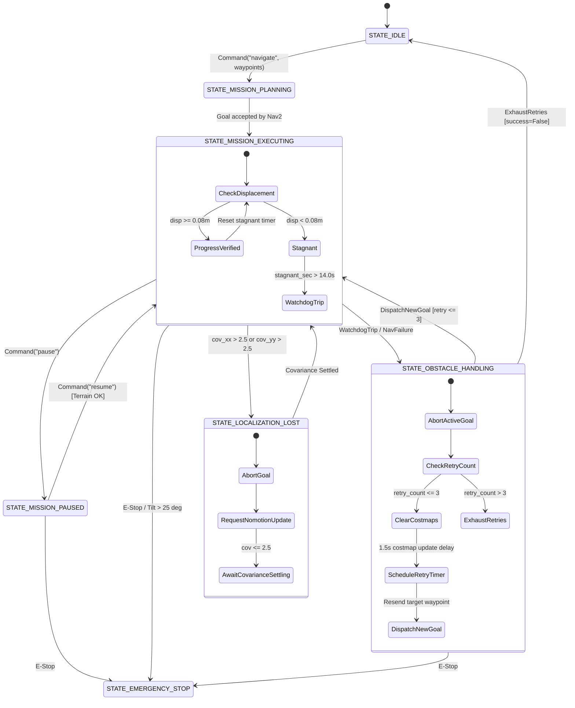

# GRaCEmo ViRa — Mission Recovery & Watchdog Algorithm Analysis

**Project:** GRaCEmo ViRa Autonomous Humanoid Service Robot  
**Auditor:** Principal Robotics Research Scientist & Autonomous Systems Architect  
**Modules Investigated:** `ros2_ws/src/gracemo_nav2/gracemo_nav2/coordinator_node.py`  
**Focus:** Area B (Mission Continuity), Area C (Trajectory Watchdog), Area E (Localization Recovery)

---

## 1. Executive Summary

This report delivers a mathematical, state-machine, and behavioral analysis of the autonomous recovery mechanisms in GRaCEmo ViRa. Special emphasis is placed on the trajectory watchdog and localization health systems that were remediated in November 2026 to resolve the critical "advancing RViz while stationary in Gazebo" divergence.

### Core Discoveries
1. **The November 2026 Breakthrough:** The primary failure was traced to a feedback callback coupling bug where incoming 20 Hz action feedback continuously reset the watchdog stagnation timer, neutralizing stall detection. Remediation decoupled progress detection from feedback arrival and tied it strictly to spatial displacement in the map frame ($\Delta d \ge 0.08\text{ m}$).
2. **Recovery Model:** Bounded, non-blocking asynchronous recovery with exponential retry back-off (up to 3 retries), asynchronous costmap clearing, and AMCL non-motion updates.
3. **Patent Assessment:** The implemented mechanism is an exemplary, production-grade engineering solution. However, its mathematical foundation ($\Delta d \ge \epsilon$ within $\Delta t$) is fundamentally identical to Nav2's `SimpleProgressChecker` and iRobot's prior art. We detail the necessary transition to kinematic slip-fused recovery to attain patent novelty.

---

## 2. Mathematical Formulation of the Trajectory Watchdog

The trajectory watchdog operates as a periodic supervisory thread running at 10 Hz ($\Delta t_{check} = 100\text{ ms}$).

### 2.1 State & Spatial Variables
- Let $\mathcal{S}$ be the current supervisory state:
  $$\mathcal{S} \in \{\text{STATE\_IDLE}, \text{STATE\_MISSION\_PLANNING}, \text{STATE\_MISSION\_EXECUTING}, \text{STATE\_MISSION\_PAUSED}, \text{STATE\_OBSTACLE\_HANDLING}, \text{STATE\_LOCALIZATION\_LOST}, \text{STATE\_EMERGENCY\_STOP}\}$$
- The watchdog is active if and only if:
  $$\mathcal{S} = \text{STATE\_MISSION\_EXECUTING} \quad \land \quad \mathbf{h}_{goal} \ne \text{None}$$
  where $\mathbf{h}_{goal}$ is the active Nav2 action client goal handle.
- At time $t_k$, the coordinator queries the transform buffer for the latest transform from the global map frame to the base footprint frame:
  $$\mathbf{T}_{map}^{base}(t_k) = \begin{pmatrix} \mathbf{R}(\theta_k) & \mathbf{p}(t_k) \\ \mathbf{0}^T & 1 \end{pmatrix}, \quad \mathbf{p}(t_k) = \begin{pmatrix} x(t_k) \\ y(t_k) \end{pmatrix} \in \mathbb{R}^2$$

### 2.2 Progress Verification Condition
Let $\mathbf{p}_{prog} = (x_{prog}, y_{prog})^T$ be the robot's spatial coordinate at the last verified progress event, and $t_{prog}$ be the timestamp of that event.

$$\Delta d(t_k) = \|\mathbf{p}(t_k) - \mathbf{p}_{prog}\|_2 = \sqrt{(x(t_k) - x_{prog})^2 + (y(t_k) - y_{prog})^2}$$

The progress invariant is defined as:

$$\mathcal{C}_{progress}(t_k) \iff \Delta d(t_k) \ge \epsilon_{disp} \quad (\epsilon_{disp} = 0.08\text{ meters})$$

If $\mathcal{C}_{progress}(t_k)$ evaluates to `True`:
$$\mathbf{p}_{prog} \leftarrow \mathbf{p}(t_k), \quad t_{prog} \leftarrow t_k$$
and execution returns without tripping.

### 2.3 Stagnation & Mission Timeout Conditions
If $\mathcal{C}_{progress}(t_k)$ evaluates to `False`, the elapsed stagnant duration and total mission duration are computed:

$$\Delta t_{stagnant}(t_k) = t_k - t_{prog}$$
$$\Delta t_{total}(t_k) = t_k - t_{start}$$

The watchdog trips if either condition is satisfied:

$$\mathcal{T}_{trip}(t_k) \iff (\Delta t_{stagnant}(t_k) > \tau_{stagnant}) \lor (\Delta t_{total}(t_k) > \tau_{total})$$

where:
- $\tau_{stagnant} = 14.0\text{ seconds}$ (Maximum allowable immobilization while under active drive commands)
- $\tau_{total} = 180.0\text{ seconds}$ (Maximum allowable wall-clock duration for any single waypoint leg)

---

## 3. The Autonomous Recovery State Machine

When $\mathcal{T}_{trip}(t_k)$ evaluates to `True`, the coordinator initiates the **Bounded Obstacle Recovery Protocol**:

### 3.1 Step-by-Step Recovery Execution Trace
1. **Goal Cancellation:** Calls `active_goal_handle.cancel_goal_async()`. This halts the DWB local controller immediately, stopping velocity commands on `/cmd_vel_nav`.
2. **State Transition:** Enters `STATE_OBSTACLE_HANDLING` with diagnostic string `f"Obstacle intervention: retry {retry_count}/{max_retries}"`.
3. **Asynchronous Costmap Purging:** Invokes two ROS 2 services asynchronously:
   - `/global_costmap/clear_entirely_global_costmap` (`nav2_msgs/srv/ClearEntireCostmap`)
   - `/local_costmap/clear_entirely_local_costmap` (`nav2_msgs/srv/ClearEntireCostmap`)
   This removes ghost dynamic obstacles, transient LiDAR noise, and stale costmap footprints.
4. **Settling Delay Window:** Spawns a non-blocking daemon timer (`threading.Timer(1.5, self._retry_current_goal)`). This gives the costmap servers 1.5 seconds to ingest fresh LiDAR scans and re-inflate valid obstacles.
5. **Re-planning & Re-dispatch:** From the robot's current estimated pose $\mathbf{p}(t_{retry})$, a new global plan is requested to the active waypoint $\mathbf{p}_{wp}$.
6. **Failure Bounding:** If $r > 3$, recovery halts. The mission is aborted to `STATE_IDLE`, and an audible failure notification is published.

---

## 4. Localization Degradation & Nomotion Recovery (Area E)

### 4.1 Covariance Thresholding
AMCL publishes particle filter uncertainty via `geometry_msgs/PoseWithCovarianceStamped`. The coordinator tracks position variance:

$$\text{Tr}(\mathbf{\Sigma}_{pos}) = \sigma_{xx}^2 + \sigma_{yy}^2$$

The system declares a localization emergency if:
$$\sigma_{xx}^2 > 2.5\text{ m}^2 \quad \lor \quad \sigma_{yy}^2 > 2.5\text{ m}^2$$

### 4.2 Nomotion Update Service Call
Standard AMCL only updates particle weights when the robot moves by a minimum distance ($\Delta d > 0.2\text{ m}$) or angle ($\Delta \theta > 0.2\text{ rad}$). If the robot is lost and stationary, AMCL is frozen.
To resolve this, `coordinator_node.py` calls:
`/request_nomotion_update` (`std_srvs/srv/Empty`)

This forces AMCL to immediately evaluate current LiDAR scan rays against the occupancy grid map without requiring robot movement, rapidly collapsing the particle dispersion cloud.

---

## 5. Prior-Art Comparison with Nav2 Built-in Recovery

| Dimension | Nav2 BehaviorTree Recovery | GRaCEmo Trajectory Watchdog | Proposed Slip-Fused Recovery |
|---|---|---|---|
| **Execution Layer** | Inside Nav2 BT Navigator / Controller Server | In external high-level supervisory node | In cross-layer Mission Integrity Monitor |
| **Trigger Source** | Local controller failure or `SimpleProgressChecker` | Map frame TF Euclidean displacement check | Kinematic Consistency Ratio $\Gamma < 0.4$ |
| **Ghost Odometry Vulnerability** | **High:** If wheel encoders integrate wheel spin, `SimpleProgressChecker` is fooled. | **Moderate:** Relies on AMCL map pose; can be fooled if AMCL drifts with odometry on symmetric walls. | **Zero:** Mathematically immune; cross-validates LiDAR ICP against wheel encoders. |
| **Costmap Recovery** | Built-in BT action `ClearEntireCostmap` | Asynchronous service calls with 1.5 s settling window | Layered clearing with transient cost decay |
| **Nomotion Integration** | Not natively invoked by BT Navigator | Asynchronously invoked upon covariance degradation | Invariant-driven with sensory sweep rotation |

---

## 6. Required Algorithmic Enhancements for Defensible Patent Claims

To establish clear patentability, the recovery state machine must incorporate:
1. **Slip-Adaptive Extrication Maneuver:** Instead of immediately re-dispatching the exact same path, if wheel slip was detected ($\Gamma_{kinematic} < 0.4$), the supervisor commands an open-loop micro-reverse ($d_{rev} = -0.15\text{ m}$) to disengage drive wheels from collision surfaces before costmap clearing.
2. **Dynamic Covariance-Gated Resumption:** The retry goal must not be dispatched on a blind 1.5 s timer; it must wait for $\text{Tr}(\mathbf{\Sigma}_{pos}) \le 1.0\text{ m}^2$, guaranteeing that the robot is localized before path re-planning.

