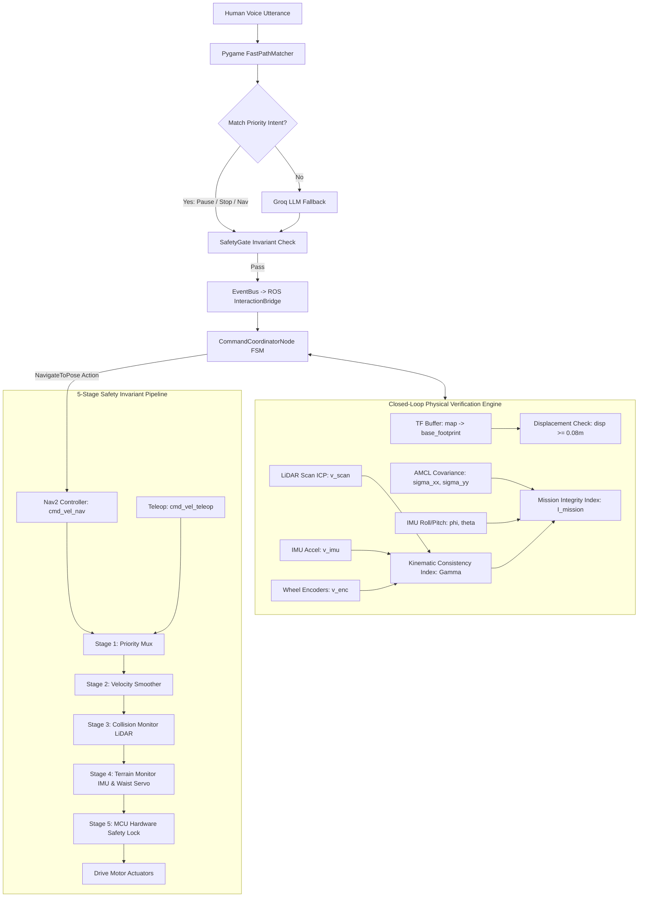

# PRELIMINARY INVENTION DISCLOSURE (CONFIDENTIAL)

**Document Reference:** GRACEMO-VIRA-PAT-2026-001  
**Date of Preparation:** November 4, 2026  
**Auditor / Technical Lead:** Principal Robotics Research Scientist & Patent Prior-Art Analyst  
**Intended Recipient:** Registered Patent Agent / IP Counsel  
**Project:** GRaCEmo ViRa Autonomous Humanoid Service Robot (`~/projects/VIRA-agent-bridge-migration`)

---

## 1. Invention Title
**Grounded Multi-Modal Mission Supervision Architecture with Closed-Loop Physical Invariant Verification and Voice-Preserved Checkpointing for Autonomous Service Robots**

---

## 2. Technical Field
This invention relates generally to autonomous mobile robots (AMRs), and more specifically to supervisory robotic controllers, real-time physical stasis and wheel slip detection, voice-interrupted mission continuity, and multi-layer cyber-physical safety interlocks.

---

## 3. Problem Statement
In autonomous service and humanoid mobile robots operating under high-level cognitive or voice supervision, conventional architectures suffer from three critical failure modes:
1. **Ghost Odometry and Stasis Divergence:** When a robot experiences drive wheel slip (e.g. contact with an unmapped low-profile obstacle or slick floor), wheel encoders report wheel rotation. Standard odometry integration reports advancing motion. Path planning feedback loops indicate nominal forward progress, causing the remote visualizer (e.g. RViz) to render the robot advancing toward its goal while the physical chassis remains completely stationary.
2. **Feedback-Loop Watchdog Neutralization:** Standard supervisory watchdogs often reset stagnation timers based on high-frequency navigation feedback messages (e.g., 20 Hz action feedback), failing to detect that spatial displacement has completely ceased.
3. **Destructive Mission Interruption:** When an ongoing multi-waypoint autonomous mission is interrupted by natural human voice instructions, existing systems typically abort the mission entirely, requiring complete re-homing, re-localization, or manual task reconstruction from scratch.

---

## 4. Existing Approaches and Their Deficiencies
- **Mechanical Stasis Followers (iRobot US 2013/0310978):** Rely on unpowered mechanical follower wheels with optical encoders to detect true displacement. Deficiencies: High mechanical complexity, susceptibility to dirt/carpet jamming, and lack of integration with LiDAR SLAM.
- **Nav2 SimpleProgressChecker (ROS 2):** Evaluates displacement over a fixed time window inside the local controller server. Deficiencies: Tightly coupled to controller feedback; susceptible to ghost odometry when odometry integrates slipping wheels.
- **UI Touchscreen Interruption (Savioke US 11,268,816):** Allows manual pausing via touchscreens. Deficiencies: Lacks natural multi-modal voice grounding and does not cross-verify kinematic slip before allowing mission resumption.

---

## 5. Specific Technical Contribution
This invention introduces a novel supervisory control architecture comprising:
1. **Multi-Sensor Kinematic Consistency Ratio ($\Gamma$):** Real-time mathematical comparison between LiDAR scan-matching velocity, IMU linear acceleration, and wheel encoder odometry, detecting wheel slip and ghost motion in $< 1.0\text{ s}$ without mechanical follower wheels.
2. **Independent Dual-Threshold Supervisory Watchdog:** High-level spatial displacement verification ($\Delta d \ge 0.08\text{ m}$) evaluated strictly in the global map frame on an independent supervisory clock, fully decoupled from action feedback frequency.
3. **Compound Autonomous Mission Integrity Index ($\mathcal{I}$):** Unified metric synthesizing kinematic consistency, AMCL localization covariance, and 3D terrain roll/pitch angles into a single decision threshold for atomic mission pausing, extrication, and recovery.
4. **Voice-Preserved Multi-Waypoint Checkpointing:** State-preserving interruption architecture that caches topological waypoints and re-dispatches goals from the current pose without re-homing.
5. **Serialized 5-Stage Safety Invariant Cascade:** Priority multiplexing $\to$ dynamic smoothing $\to$ LiDAR zone scaling $\to$ inertial terrain slope throttling with active waist pitch counterbalancing $\to$ hardware motor lock.

---

## 6. Complete System Architecture & Flowchart

---

## 7. Mathematical Formulations

### 7.1 Kinematic Consistency Ratio ($\Gamma$)
$$\Gamma_{kinematic}(t) = \frac{\min\left(\|\mathbf{v}_{scan}(t)\|_2, \|\mathbf{v}_{IMU}(t)\|_2\right) + \delta}{\|\mathbf{v}_{enc}(t)\|_2 + \delta}$$
where $\delta = 10^{-4}\text{ m/s}$. Drive wheel slip is flagged when $\Gamma_{kinematic}(t) < \gamma_{slip} = 0.40$.

### 7.2 Autonomous Mission Integrity Metric ($\mathcal{I}_{mission}$)
$$\mathcal{I}_{mission}(t) = w_1 \cdot \text{sigmoid}\left(k_\Gamma (\Gamma(t) - \gamma_{slip})\right) + w_2 \cdot \exp\left(-\frac{\text{Tr}(\mathbf{\Sigma}_{AMCL}(t))}{2 \sigma_0^2}\right) + w_3 \cdot \cos(\phi(t)) \cos(\theta(t))$$
where $w_1 = 0.50, w_2 = 0.30, w_3 = 0.20$.

### 7.3 Independent Supervisory Progress Invariant
$$\Delta d(t) = \|\mathbf{p}(t) - \mathbf{p}(t_{prog})\|_2 \ge \epsilon_{disp} \quad (\epsilon_{disp} = 0.08\text{ m})$$
If $\Delta d(t) < \epsilon_{disp}$ for $\Delta t_{stagnant} > 14.0\text{ s}$, abort active goal and clear costmaps.

---

## 8. Detailed Implementation Source Code References

| Invention Element | File Path | Class / Function Name | Key Code Reference |
|---|---|---|---|
| **Voice Intent Fast Path** | `vira_interaction/core/fast_path.py` | `FastPathMatcher.match` | Regex matching for NAVIGATE, PAUSE, RESUME, STOP |
| **Landmark Grounding** | `vira_interaction/core/place_resolver.py` | `PlaceResolver.resolve_place` | Spatial coordinates lookup with boundary checking |
| **Safety Gate Filter** | `vira_interaction/core/safety_gate.py` | `SafetyGate.evaluate_action` | Rate limits, forbidden phrases, E-stop latching |
| **Supervisory State FSM** | `ros2_ws/.../gracemo_nav2/coordinator_node.py` | `CommandCoordinatorNode` | States: `IDLE`, `PLANNING`, `EXECUTING`, `PAUSED`, etc. |
| **Trajectory Watchdog** | `ros2_ws/.../gracemo_nav2/coordinator_node.py` | `_check_navigation_watchdog` | Lines 576–598: Map frame displacement $\ge 0.08\text{ m} / 14\text{ s}$ |
| **Costmap Recovery** | `ros2_ws/.../gracemo_nav2/coordinator_node.py` | `_handle_navigation_failure` | Asynchronous global/local costmap clear + 1.5s retry |
| **Priority Command Mux** | `ros2_ws/.../gracemo_nav2/cmd_vel_mux_node.py` | `CmdVelMuxNode` | Teleop priority 1 vs Nav priority 2, 500ms timeout |
| **Terrain Monitor & Tilt** | `ros2_ws/.../gracemo_nav2/terrain_monitor_node.py` | `TerrainMonitorNode` | Roll/pitch speed reduction & active waist counterbalance |
| **Hardware Safety Lock** | `ros2_ws/.../gracemo_hardware/mcu_transport.py` | `SerialMCUTransport` | `MOTOR_OUTPUT_ENABLED = 0`, `PROTOCOL_CONFIRMED = False` |

---

## 9. Potential Patent Claims (Preliminary Engineering Concepts)

### Concept 1: Exemplary Independent System Claim
> **Claim 1 (Robotic Supervisory System):**  
> An autonomous mobile robot system comprising:  
> - a mobile chassis having motor-driven wheels, an inertial measurement unit (IMU), a laser scanning sensor, and wheel rotation encoders;  
> - a navigation controller configured to generate velocity commands for driving said wheels toward a navigation goal;  
> - a voice interaction interface configured to receive speech utterances and identify mission interruption commands;  
> - a supervisory safety controller communicatively coupled to said motor-driven wheels and sensors, said supervisory controller configured to:  
>   (a) execute an autonomous multi-waypoint mission by dispatching waypoints to said navigation controller;  
>   (b) upon receiving a voice interruption command, pause mission execution, cancel active velocity commands to said wheels, and preserve an index of the active waypoint;  
>   (c) calculate, during active mission execution, a kinematic consistency ratio ($\Gamma$) comparing velocity derived from said laser scanning sensor and said IMU against velocity derived from said wheel rotation encoders;  
>   (d) determine a physical stasis condition when said kinematic consistency ratio falls below a predetermined slip threshold; and  
>   (e) upon detecting said physical stasis condition, automatically preempt said navigation controller, command zero torque to said motor-driven wheels, and initiate an autonomous obstacle clearing recovery sequence.

### Concept 2: Exemplary Independent Method Claim
> **Claim 2 (Method for Supervising Mobile Robot Autonomy):**  
> A method for safe mission supervision and stasis prevention in an autonomous mobile robot, the method comprising:  
> - receiving, at an interaction gateway, natural language speech commands;  
> - routing recognized intents through a multi-stage safety gate enforcing spatial boundary and rate-limit invariants;  
> - monitoring physical progress of said robot using an independent supervisory timer in a global map frame;  
> - detecting physical chassis stall when Euclidean displacement in said map frame is less than a predetermined displacement threshold ($\epsilon_{disp}$) for an elapsed duration exceeding a stagnation limit ($\tau_{stagnant}$);  
> - calculating an autonomous mission integrity metric synthesizing kinematic consistency, localization particle filter covariance, and 3D terrain attitude; and  
> - dynamically regulating robot velocity through a serialized five-stage safety cascade comprising priority multiplexing, acceleration smoothing, LiDAR footprint zone scaling, inertial tilt slope throttling, and hardware gate lockout.

### Concept 3: Exemplary Dependent Claim Concepts
- **Claim 3:** The system of Claim 1, wherein said independent supervisory controller evaluates Euclidean displacement in a global map coordinate frame using coordinate transform lookups completely decoupled from the frequency of action feedback messages from said navigation controller.
- **Claim 4:** The system of Claim 1, wherein said recovery sequence comprises asynchronously invoking clear services on global and local obstacle costmaps, holding motor torque for an obstacle inflation delay window, and re-dispatching a navigation trajectory to said preserved active waypoint from the current robot pose.
- **Claim 5:** The system of Claim 1, further comprising an active torso pitch actuator, wherein said supervisory controller dynamically computes a counterbalancing pitch angle proportional to measured terrain pitch to prevent dynamic tip-over during ramp traversal.

---

## 10. Legal & Patentability Analysis

### 10.1 Indian Patents Act, 1970 — Section 3(k) Assessment
- **Risk:** Section 3(k) bars "a computer programme per se or algorithms".
- **Mitigation Strategy:** Claims 1 and 2 are expressly constructed around **tangible physical hardware elements** (chassis, wheels, motor actuators, laser scanners, IMU, encoders). The novelty produces a direct **physical technical effect**: preventing mechanical motor damage, tire friction burnout, dynamic tipping, and physical collision. Under Delhi High Court precedents (*Ferid Allani v. Union of India* and *Ericsson v. Intex*), computer-related inventions having technical effect and physical integration are fully patent-eligible.

### 10.2 US Patent Law — 35 U.S.C. §§ 101, 102, 103 Assessment
- **Section 101:** Passes both prongs of Alice/Mayo (improves the operation of a physical robotic vehicle).
- **Section 102 (Novelty):** The specific combination of contactless kinematic consistency calculation ($\Gamma$) governing supervisory mission state preservation is not anticipated by iRobot (mechanical wheels) or Savioke (touchscreen routing).
- **Section 103 (Non-Obviousness):** While individual modules (AMCL, Nav2, regex) exist in open source, their specific mathematical coupling into a multi-sensor slip-fused mission integrity supervisor addresses a recognized, long-felt failure mode (ghost odometry) and provides a defensible non-obvious combination.

