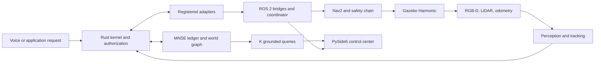

# GRaCEmo ViRa

**ROS 2 Jazzy and Gazebo Harmonic robotics platform**

Rust event kernel · Python perception and adapters · Nav2 simulation


[](https://github.com/muzamil-ashiq/gracemo-vira/actions/workflows/rust.yml?query=branch%3ASAM_NEW)

GRaCEmo ViRa connects mission reasoning, persistent memory, authorized adapters, and ROS 2 navigation. The supported development target is desktop Gazebo simulation. **The current release is on validation hold**: the autonomous patrol baseline works, while visual SLAM, reliable dynamic recovery, and other acceptance gates remain in progress. This repository does not claim physical-robot or Jetson acceptance.

## Verified capabilities

Each result links to its report or saved run evidence. Status reflects measured evidence, not planned capability.

| Feature | Measured on | Result | Evidence |
|---|---|---|---|
| Five-room autonomous patrol | Gazebo Harmonic | 11/11 waypoints; 185.6 s | [Patrol result](docs/validation/visual_all_03/patrol_after_fixes/patrol.json) · [visual acceptance report](docs/validation/VIR-VISUAL-ALL-03-FINAL-REPORT.md) |
| Idle-zero safety | Gazebo Harmonic | Command peaks 0; displacement 0.007915 m | [Idle-zero evidence](docs/validation/visual_all_03/patrol_after_fixes/idle_zero.json) |
| Visual object to navigation | Gazebo RGB-D + ROS 2/Nav2 | Monitor detected and authorized goal completed | [Latest live run](docs/validation/VIR-VISUAL-ALL-04-FINAL-REPORT.md) |
| Visual odometry | Gazebo trajectory vs independent ground truth | **Does not meet target:** 1.6555 m translation RMSE, 26.68° rotation RMSE, 35.68% availability | [Measured limitations](docs/validation/VIR-VISUAL-ALL-03-FINAL-REPORT.md) |
| Saved-map relocalization and route | Independent Gazebo restarts | **1/10 routes**; acceptance not met | [Restart evidence and blockers](docs/validation/VIR-VISUAL-ALL-03-FINAL-REPORT.md) |
| RGB-D visual SLAM / loop closure | ROS 2 Jazzy desktop | Not integrated or accepted | [Visual intelligence programme report](docs/validation/VIR-VISUAL-ALL-04-FINAL-REPORT.md) |

The Rust workflow runs the kernel workspace tests. It does not stand in for ROS 2, Gazebo, GUI, physical-robot, or hardware acceptance.

## System architecture



The active simulation pipeline is Gazebo sensors → ROS 2 → perception → kernel/MNSE → K and authorized adapters → ROS 2/Nav2 → Gazebo. AMCL remains the primary Nav2 localization source until visual localization meets its independent acceptance thresholds. Safety monitoring, command arbitration, collision monitoring, and E-stop remain in the motion path.

## Repository map

| Path | Responsibility |
|---|---|
| `kernel/` | Rust kernel, K execution, event types, SQLite ledger and world graph |
| `adapters/` | Perception, vision, SDK, and reasoning adapters |
| `ros2_ws/src/gracemo_bridge/` | ROS 2 sensor, kernel, and interaction bridges |
| `ros2_ws/src/gracemo_gazebo/` | Gazebo Harmonic robot simulation and worlds |
| `ros2_ws/src/gracemo_nav2/` | Nav2 configuration, coordinator, safety and navigation behavior |
| `gracemo_control_center/` | PySide6 simulation control and monitoring interface |
| `vira_interaction/` | Voice and interaction runtime |
| `scripts/` | Launch, mission, readiness, and validation entry points |
| `docs/` | Architecture, operating guides, acceptance reports, and evidence index |
| `tests/` | Rust, Python, ROS 2, and end-to-end regression tests |

See [Documentation index](docs/INDEX.md) for setup, architecture, operating and validation guides.

## Run the Gazebo simulation

### Prerequisites

- Ubuntu with ROS 2 Jazzy
- Gazebo Harmonic and the ROS/Gazebo integration packages declared by the workspace
- Rust toolchain and Python dependencies for the selected components

Build from the repository root:

```bash
source /opt/ros/jazzy/setup.bash
cd ros2_ws
colcon build --symlink-install --packages-up-to gracemo_gazebo gracemo_nav2 gracemo_rl gracemo_bridge
cd ..
python3 scripts/check_simulation_model_consistency.py
```

Launch the full simulation with the supported launcher:

```bash
./scripts/launch_full_simulation.sh --no-gui
```

To run the five-room simulation patrol:

```bash
./scripts/launch_full_simulation.sh --patrol --no-gui
```

For the adapter → kernel → ROS 2 → Nav2 → Gazebo path, start the simulation in one terminal and run the mission runner in another:

```bash
cargo build --manifest-path kernel/Cargo.toml --bin gracemo-kernel
./scripts/launch_full_simulation.sh
```

```bash
source /opt/ros/jazzy/setup.bash
source ros2_ws/install/setup.bash
python3 scripts/run_autonomous_mission.py --timeout 300 \
  --out docs/validation/adapter_kernel_gazebo_patrol.json
```

The launcher and mission runner perform readiness checks and record results. Use only the private Gazebo simulation configuration for motion tests. Do not connect this workflow to a physical robot.

## Run checks

Rust kernel workspace:

```bash
cargo test --locked --manifest-path kernel/Cargo.toml
```

Perception and ROS depth tests:

```bash
source /opt/ros/jazzy/setup.bash
source ros2_ws/install/setup.bash
export PYTHONPATH="$PWD:$PWD/adapters/sdk:$PWD/vira_interaction:$PWD/ros2_ws/src/gracemo_bridge:$PYTHONPATH"
python3 -m pytest -q tests/test_edge_vision.py tests/test_perception_pipeline.py \
  tests/ros2/test_gazebo_depth_frame.py
```

Kernel API integration tests use a private local listener:

```bash
PYTHONPATH="$PWD/adapters/sdk:$PYTHONPATH" \
  python3 -m pytest -q tests/e2e/test_visual_memory.py
```

## Contributing and project status

Read [CONTRIBUTING.md](CONTRIBUTING.md) before changing navigation, perception, authorization, or safety behavior. Keep simulation results reproducible, preserve existing user changes, and report failed thresholds plainly. No measurement in this repository should be described as physical-robot validation unless a separate authorized hardware programme produces that evidence.

Current release gates and measured limitations are tracked in the [project gap report](docs/PROJECT_GAPS_AND_SIMULATION_STATUS.md) and the [VIR-VISUAL-ALL-04 report](docs/validation/VIR-VISUAL-ALL-04-FINAL-REPORT.md).
