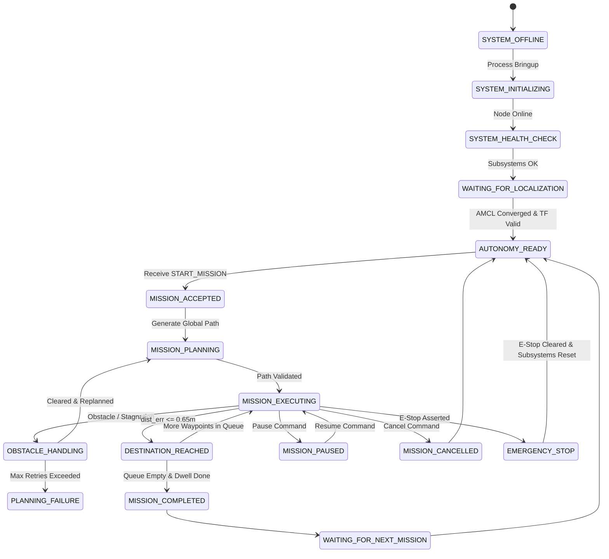

# GRaCEmo ViRa — Autonomous Mission Workflow

**Document Version:** 1.0.0  
**Status:** VERIFIED  

---

## 1. Mission Lifecycle State Machine (FSM)

The Autonomous Supervisor enforces an 11-state deterministic Finite State Machine:



---

## 2. Mission Stages Breakdown

### 2.1 Stage 1: Ingestion & Boundary Validation
- Mission requests are accepted on `/coordinator/command` formatted as JSON:
  ```json
  {
    "intent": "START_MISSION",
    "mission_name": "Living Room Inspection",
    "waypoints": [
      {
        "name": "Living Room Center",
        "coords": {"x": 2.5, "y": -1.2, "yaw": 1.57},
        "dwell_sec": 5.0
      }
    ]
  }
  ```
- The supervisor validates coordinate boundaries against map dimensions ($X \in [-10.0, 10.0]$, $Y \in [-10.0, 10.0]$).
- If coordinates are out of bounds or invalid, the supervisor rejects the mission and logs the event to EventBus.

### 2.2 Stage 2: Global Path Planning
- The supervisor sends an action goal to Nav2 `navigate_to_pose`.
- `NavfnPlanner` queries the global costmap and computes the shortest obstacle-free trajectory to target pose $(X, Y, \text{Yaw})$.
- If the target is inside an inflated obstacle, Nav2 attempts local search or fails gracefully (`PLANNING_FAILURE`), triggering recovery.

### 2.3 Stage 3: Trajectory Execution & Closed-Loop Control
- DWB local planner computes velocities at 20 Hz.
- Linear and angular velocities are constrained to:
  - $v_{\text{max}} = 0.40\text{ m/s}$
  - $\omega_{\text{max}} = 0.80\text{ rad/s}$
- The velocity pipeline applies smoothing, collision footprint checking, and terrain attitude gating.

### 2.4 Stage 4: Closed-Loop Physical Arrival Verification
- The supervisor does not rely solely on Nav2 `STATUS_SUCCEEDED`.
- It performs independent mathematical verification:
  $$d_{\text{err}} = \sqrt{(X_{\text{target}} - X_{\text{robot}})^2 + (Y_{\text{target}} - Y_{\text{robot}})^2}$$
- Acceptance requires $d_{\text{err}} \le 0.65\text{ m}$.
- Upon confirmed arrival, the supervisor transitions to `DESTINATION_REACHED` and counts down the requested `dwell_sec`.

### 2.5 Stage 5: Multi-Waypoint Queue Processing
- If additional waypoints remain in the queue, the supervisor pops the next waypoint and transitions to `MISSION_PLANNING`.
- When all waypoints complete, the supervisor transitions to `MISSION_COMPLETED` $\rightarrow$ `WAITING_FOR_NEXT_MISSION` $\rightarrow$ `AUTONOMY_READY`.
