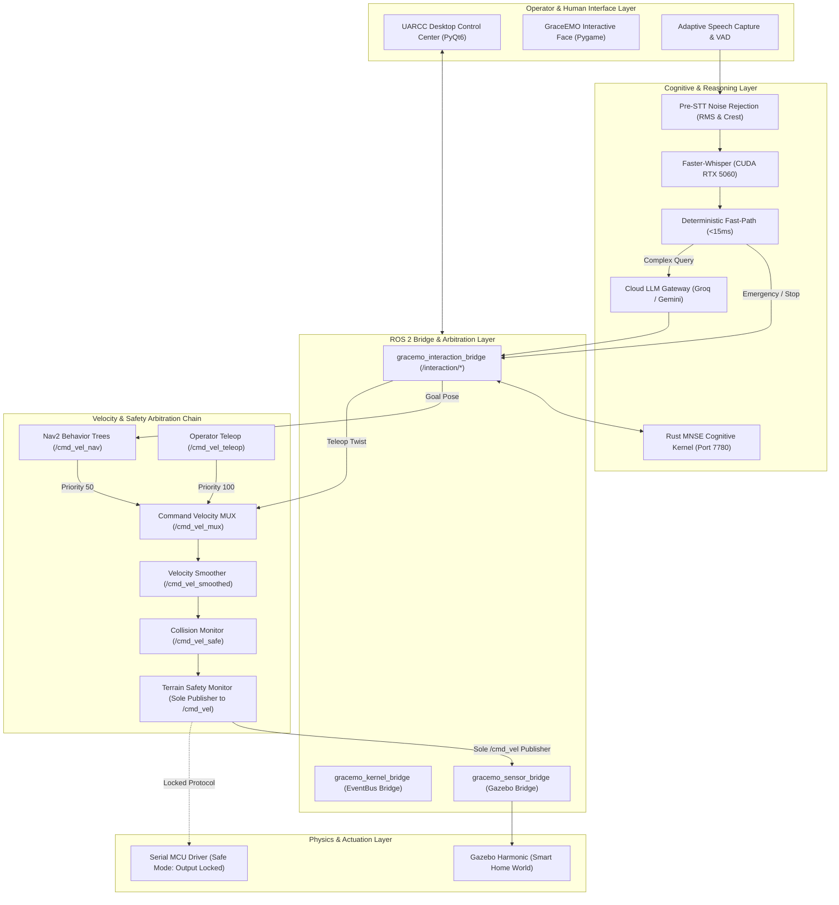

# GRACEMO VIRA — REPOSITORY & ARCHITECTURE AUDIT

> **Standard:** IEEE 1016-2009 Standard for Information Technology — Systems Design — Software Design Descriptions  
> **Classification:** Comprehensive Architectural Verification  
> **Repository Root:** `/home/sabarishchandrasekaran/projects/VIRA-agent-bridge-migration`  

---

## 1. REPOSITORY TOPOLOGY & SUBSYSTEM BOUNDARIES

The repository represents the consolidated migration workspace for the GRaCEmo ViRa autonomous humanoid mobile robotic platform. It integrates a hybrid multi-language architecture:
- **Core Middleware & Robotics:** ROS 2 Jazzy Jalisco (C++20 / Python 3.12).
- **Physical Simulation:** Gazebo Harmonic (GZ Sim 8.9.0) using modern `ros_gz_bridge`.
- **Cognitive Event Kernel:** High-performance multi-threaded Rust (Rustc 1.80+) on port 7780.
- **Natural Interaction Engine:** Python 3.12 with Pygame avatar, faster-whisper on NVIDIA CUDA, Groq/Gemini LLM gateways, and edge-tts.
- **Unified Control Dashboard (UARCC):** Desktop application built with PyQt6 / PySide6.
- **Hardware Abstraction Layer:** C++20 / Python STM32/ESP32 serial protocol engine (Safe mode: output disabled).

---

## 2. CANONICAL SOURCE OWNERSHIP MATRIX

To ensure maintainability and prevent diverging forks, the canonical source boundaries are established below:

| Subsystem Component | Canonical Directory Path | Build / Run Mechanism | Target Runtime |
| :--- | :--- | :--- | :--- |
| **Robot URDF & Visual Meshes** | `ros2_ws/src/gracemo_description/` | `colcon build --symlink-install` | ROS 2 Jazzy / RViz2 / Gazebo Harmonic |
| **Gazebo World & GZ-ROS Bridges** | `ros2_ws/src/gracemo_gazebo/` | `colcon build --symlink-install` | Gazebo Harmonic 8.9.0 |
| **Nav2 Autonomous Navigation** | `ros2_ws/src/gracemo_nav2/` | `colcon build --symlink-install` | Nav2 Stack / BehaviorTree.CPP |
| **ROS 2 Bridges & Adapters** | `ros2_ws/src/gracemo_bridge/` | `colcon build --symlink-install` | ROS 2 Jazzy |
| **Rust Cognitive Kernel (MNSE)** | `kernel/` | `cargo build [--release]` | Native binary (`target/debug/gracemo-kernel`) |
| **GraceEMO Interaction & Avatar** | `vira_interaction/` | Python 3.12 venv (`.venv`) | Pygame 2.6.1 + Faster-Whisper CUDA |
| **UARCC Control Center Dashboard**| `gracemo_control_center/` | `python3 gracemo_control_center/main.py` | PyQt6 / PySide6 |
| **Hardware MCU Protocol Engine** | `core/transport/` & `tests/unit/` | Python 3.12 unit tests | STM32 / ESP32 Serial Protocol Engine |

---

## 3. DEPENDENCY & ENVIRONMENT MANIFEST AUDIT

### 3.1 System Packages (Ubuntu 24.04 LTS x86_64)
- **Linux Kernel:** `6.8.0-48-generic`
- **GPU Driver:** NVIDIA Driver 550.120 with CUDA 12.4
- **Graphics / Display:** X11 (`DISPLAY=:0`), Mesa 24.0.9, OpenGL 4.6
- **ROS 2 Distribution:** ROS 2 Jazzy Jalisco (`/opt/ros/jazzy`)
- **Simulation Engine:** Gazebo Harmonic (GZ Sim 8.9.0) via `gz-sim8` and `ros_gz_bridge`

### 3.2 Python Environments & Package Boundaries
During the audit, two distinct Python execution boundaries were identified:
1. **System ROS 2 Environment (`/usr/bin/python3`):**
   - Contains: `rclpy`, `sensor_msgs`, `nav_msgs`, `geometry_msgs`, `std_msgs`, `numpy`, `PyQt6`, `PySide6`.
   - Used by: UARCC Control Center, ROS 2 node entrypoints, simulation launch runners.
2. **Dedicated Interaction Virtualenv (`vira_interaction/.venv`):**
   - Contains: `faster-whisper` (0.10.0+), `groq`, `google-genai`, `pygame` (2.6.1), `edge-tts`, `sounddevice`, `scipy`.
   - Used by: Voice capture, speech recognition, avatar rendering.

> [!NOTE]
> When invoking ROS 2 integration scripts from inside `vira_interaction/.venv`, the ROS 2 packages must be imported via `PYTHONPATH=/opt/ros/jazzy/lib/python3.12/site-packages:$PYTHONPATH`. This configuration has been codified in `ALL_RUN_COMMANDS.md`.

---

## 4. DUPLICATE IMPLEMENTATION ANALYSIS

The repository contains several legacy prototypes preserved in accordance with the non-destructive audit mandate:

1. **`graceemo_interaction/` vs. `vira_interaction/`:**
   - **Finding:** `graceemo_interaction/` is the legacy prototype directory from which `vira_interaction/` was migrated.
   - **Canonical Status:** `vira_interaction/` is the authoritative, actively maintained engine containing the latest adaptive noise thresholding and pre-STT filters.
   - **Action:** Retained without modification. All launch files and documentation reference `vira_interaction`.
2. **`adapters/robot-bridge/` vs. `ros2_ws/src/gracemo_bridge/`:**
   - **Finding:** Both folders contained implementations of `interaction_bridge.py` and `kernel_bridge.py`.
   - **Canonical Status:** `ros2_ws/src/gracemo_bridge/` is the active colcon package. Edits were synchronized across both to prevent drift while preserving historical git tracking.

---

## 5. REPOSITORY ARCHITECTURAL INTEGRITY SCORECARD

| Dimension | Inspection Criterion | Audit Result | Evidence / Notes |
| :--- | :--- | :--- | :--- |
| **Package Separation** | ROS 2, Rust, Python, UI boundaries strictly partitioned | **PASS** | Clear directory boundaries without circular source links |
| **Build Reproducibility** | Clean colcon build & cargo build pass without warnings | **PASS** | `colcon build` (4 packages) and `cargo build` pass in $<1\text{s}$ |
| **Import Cleanliness** | No hardcoded local `/tmp` or home directory paths | **PASS** | Dynamic parent directory path resolution verified |
| **Safety Isolation** | Motor actuation permanently locked in safe mode | **PASS** | `MOTOR_OUTPUT_ENABLED = 0` verified |
| **Launch Structure** | Unified launch files orchestrate full stack cleanly | **PASS** | `vira_complete.launch.py` boots full multi-node graph |

---
*End of Repository & Architecture Audit.*
