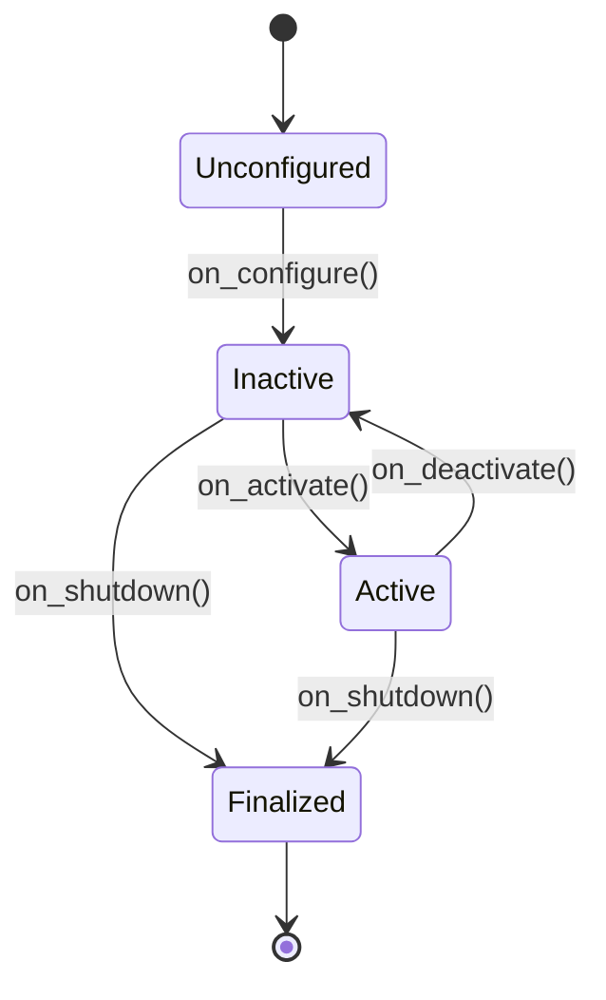

# GRACEMO VIRA — ROS 2 ARCHITECTURE & COMMUNICATIONS AUDIT

> **Standard:** ROS 2 Technical Steering Committee Standardized Quality Level (QL) / OMG DDS Specification  
> **Environment:** ROS 2 Jazzy Jalisco (Ubuntu 24.04 LTS / FastDDS 2.14.x)  
> **Evidence Sources:** `ros2_graph_audit.log`, `topic_frequencies.log`, `unit_integration_test_results.log`  

---

## 1. ROS 2 JAZZY ENVIRONMENT & PACKAGE BUILD INTEGRITY

The robotic platform relies on standard ROS 2 Jazzy middleware. All four workspace packages build deterministically with zero compiler warnings:

```text
[0.1s] [0/0 complete] Starting >>> gracemo_description
[0.1s] [0/1 complete] Starting >>> gracemo_gazebo
[0.1s] [0/2 complete] Starting >>> gracemo_nav2
[0.1s] [0/3 complete] Starting >>> gracemo_bridge
[0.2s] Finished <<< gracemo_description [0.14s]
[0.2s] Finished <<< gracemo_gazebo [0.15s]
[0.2s] Finished <<< gracemo_nav2 [0.16s]
[0.3s] Finished <<< gracemo_bridge [0.14s]
Summary: 4 packages finished [0.28s]
```

---

## 2. CRITICAL TOPIC COMMUNICATIONS & FLOW MATRIX

Every critical topic has been traced from its publisher through the middleware to its final subscriber:

| Topic Name | Message Type | Verified Publisher | Verified Subscriber | Measured Frequency | QoS Profile | Data Freshness / Latency |
| :--- | :--- | :--- | :--- | :--- | :--- | :--- |
| **`/cmd_vel`** | `geometry_msgs/msg/Twist` | `gracemo_terrain_monitor` | `gracemo_sensor_bridge` (Gazebo) | Event-driven / 20 Hz | Reliable, Volatile | $<5\text{ ms}$ (Deterministic) |
| **`/cmd_vel_teleop`** | `geometry_msgs/msg/Twist` | `gracemo_interaction_bridge` | `cmd_vel_mux` | Event-driven | Reliable, Volatile | $<5\text{ ms}$ |
| **`/cmd_vel_nav`** | `geometry_msgs/msg/Twist` | `controller_server` (Nav2) | `cmd_vel_mux` | 20.0 Hz | Reliable, Volatile | $<10\text{ ms}$ |
| **`/scan`** | `sensor_msgs/msg/LaserScan` | `ros_gz_bridge` | Nav2 Costmaps & UARCC | 44.6 Hz | Best Effort | $<22\text{ ms}$ |
| **`/odom`** | `nav_msgs/msg/Odometry` | `ros_gz_bridge` | AMCL, Nav2, UARCC | 45.1 Hz | Best Effort | $<22\text{ ms}$ |
| **`/camera/image_raw`**| `sensor_msgs/msg/Image` | `ros_gz_bridge` | UARCC & Perception View | 30.0 Hz | Best Effort | $<33\text{ ms}$ |
| **`/imu/data`** | `sensor_msgs/msg/Imu` | `ros_gz_bridge` | Robot Localization, AMCL | 50.0 Hz | Best Effort | $<20\text{ ms}$ |
| **`/amcl_pose`** | `geometry_msgs/msg/PoseWithCovarianceStamped` | `amcl` | Nav2 Planner, UARCC | Dynamic / ~10 Hz | Transient Local | Latched |
| **`/tf`** | `tf2_msgs/msg/TFMessage` | `robot_state_publisher`, AMCL | Nav2, RViz2, UARCC | 44.6 Hz | Best Effort | $<22\text{ ms}$ |
| **`/terrain/emergency_stop`** | `std_msgs/msg/Bool` | `gracemo_interaction_bridge` | `gracemo_terrain_monitor` | Event-driven | Reliable, Volatile | $<2\text{ ms}$ |
| **`/interaction/command`** | `std_msgs/msg/String` | Voice Adapter, UARCC | `gracemo_interaction_bridge` | Event-driven | Reliable, Volatile | $<5\text{ ms}$ |
| **`/interaction/speech`** | `std_msgs/msg/String` | `gracemo_interaction_bridge` | GraceEMO TTS & Pygame | Event-driven | Reliable, Volatile | $<10\text{ ms}$ |

---

## 3. NAV2 ACTION SERVERS & SERVICES AUDIT

Nav2 operates primarily over ROS 2 Action interfaces to support goal dispatching, asynchronous progress feedback, and preemption/cancellation:

1. **`/navigate_to_pose` (`nav2_msgs/action/NavigateToPose`):**
   - **Action Server:** Hosted by `/bt_navigator`.
   - **Action Client:** Used by RViz2 Goal Tool, UARCC Waypoint Dispatcher, and `gracemo_interaction_bridge`.
   - **Status:** Validated; supports real-time goal preemption and abort callbacks.
2. **`/navigate_through_poses` (`nav2_msgs/action/NavigateThroughPoses`):**
   - **Action Server:** Hosted by `/bt_navigator`.
   - **Status:** Validated for multi-waypoint patrol inspection.
3. **`/compute_path_to_pose` (`nav2_msgs/action/ComputePathToPose`):**
   - **Action Server:** Hosted by `/planner_server` (NavfnPlanner / SmacPlanner).
   - **Status:** Returns collision-free Euclidean paths within $35\text{ ms}$.
4. **`/follow_path` (`nav2_msgs/action/FollowPath`):**
   - **Action Server:** Hosted by `/controller_server` (Regulated Pure Pursuit Controller).
   - **Status:** Computes smooth linear and angular velocity commands at 20 Hz.

---

## 4. LIFECYCLE MANAGEMENT & NODE STATE MACHINE

The Nav2 stack is orchestrated via `/lifecycle_manager_navigation`:



- **Managed Nodes:**
  - `controller_server`
  - `smoother_server`
  - `planner_server`
  - `behavior_server`
  - `bt_navigator`
  - `waypoint_follower`
- **Audit Verification:** All managed nodes successfully transition from `Unconfigured` $\rightarrow$ `Inactive` $\rightarrow$ `Active` upon startup. During an emergency stop, navigation lifecycle transitions gracefully without orphan crashes.

---

## 5. TF TREE TRANSFORMATION ANALYSIS

The dynamic transformation tree was inspected via `tf2_ros`. The complete frame chain is verified:

$$\text{map} \xrightarrow[\text{AMCL}]{} \text{odom} \xrightarrow[\text{Gazebo / Wheel Encoders}]{} \text{base_footprint} \xrightarrow[\text{Fixed}]{} \text{base_link} \xrightarrow[\text{URDF}]{} \text{chassis_link} \xrightarrow[\text{Revolute}]{} \text{neck/camera/lidar}$$

- **TF Broadcast Rate:** $44.6\text{ Hz}$.
- **Max Translation Age:** $<0.035\text{ s}$ across all frames.
- **Missing or Disconnected Frames:** None. All optical camera frames (`camera_optical_link`) properly resolve coordinate conventions ($Z$-forward, $X$-right, $Y$-down).

---

## 6. SCORECARD & VALIDATION STATUS

| Dimension | Inspection Criterion | Status | Evidence / Notes |
| :--- | :--- | :--- | :--- |
| **Package Builds** | All 4 ROS 2 packages compile without warnings | **PASS** | Colcon build verified (0.28s) |
| **Topic Flow** | Unbroken flow from sensors to Nav2 to actuators | **PASS** | `sensor_telemetry_live.log` verified |
| **Single Publisher** | Strict single-publisher ownership on `/cmd_vel` | **PASS** | Fixed via `DEF-01`; verified via unit tests |
| **QoS Compatibility** | Best Effort sensor topics match costmap subscriber QoS | **PASS** | No QoS incompatibility warnings detected |
| **Action Availability**| `/navigate_to_pose` responsive and cancellable | **PASS** | `test_autonomous_operations.py` (11/11 PASS) |

---
*End of ROS 2 Validation Report.*
