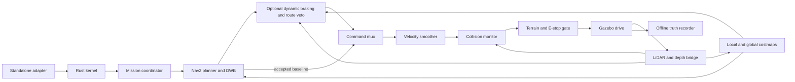
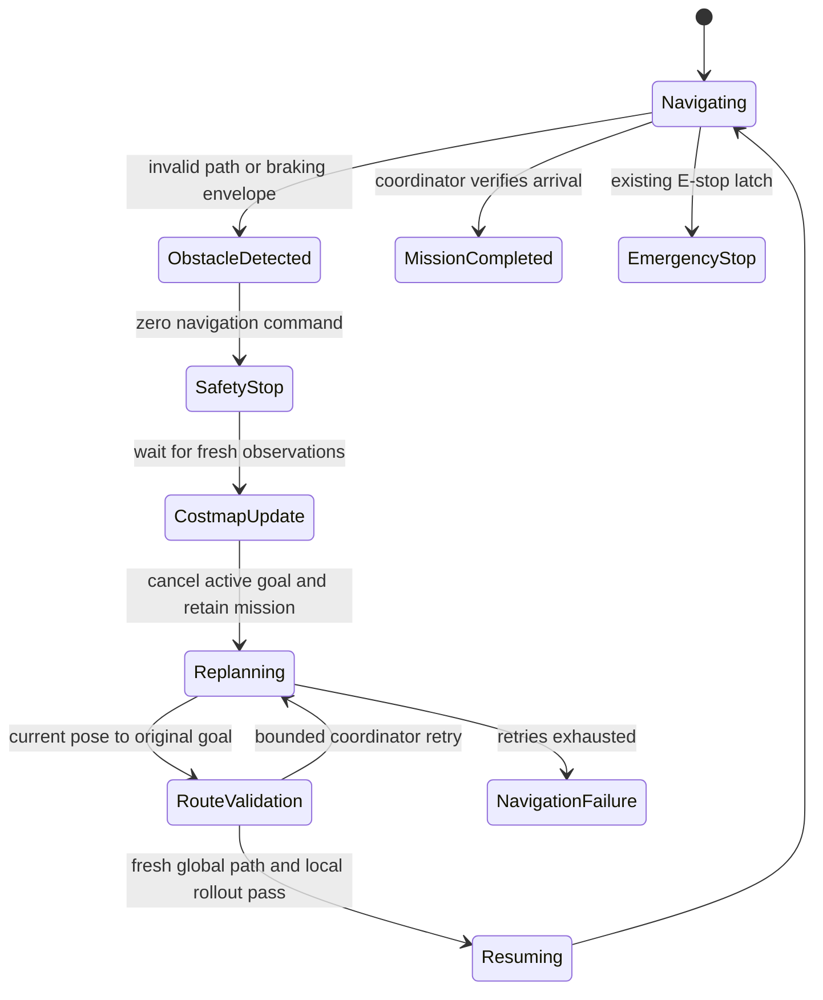

# VIRA dynamic obstacle investigation

**Release gate — dynamic autonomous recovery is experimental.** The production simulation entry point remains the five-room standalone mission. The dynamic profiles below run on private Gazebo and DDS graphs. Mission completion, actual arrival, a safe stop and clearance of proposed trajectories have separate evidence.

The [private prototype acceptance report](PRIVATE_TRIALS.md) records the subsequent deterministic trials, E-stop interruption evidence and integration decision.

## Architecture and baseline

The starting configuration is the accepted apartment map, corrected simulated depth optical frame, depth and LiDAR observations on both costmaps, NavFn, RotationShim with DWB and the path-validity/near-goal behavior tree. Global and local costmaps use 0.05 m cells. The recorder checks that Nav2 published a 0.72 × 0.70 m padded footprint. NavFn's output and the selected DWB rollout are recorded separately. The original tests and earlier partial gates are documented in the [corridor engineering report](../corridor_routing/REPORT.md).



The guard can only forward or zero a Nav2 command upstream of the existing mux. The separate fixture driver's velocity topic addresses the box model. Gazebo world poses are used for fixture control and evaluation. The navigation guard uses odometry, the published footprint, costmaps, sensor freshness and controller outputs.

## Reproduction and diagnosis

The fresh late-insertion reproduction placed the 0.35 × 0.35 m box at (2.0, −0.40) after DWB began following a route. It finished 3.026 m from the requested goal in Gazebo, with zero waypoints complete, an executed padded-clearance lower bound of −0.0332 m and a selected rollout lower bound of −0.1371 m. The earlier accepted report had a different terminal outcome for the same fixture. Both runs failed the padded-clearance gate. [Fresh geometry](reproduction/geometry.json) · [Mission](reproduction/mission.json)

For the seeded front box, the in-motion path predating insertion crossed the fixture envelope by 0.132 m. A subsequent path at 4.88 s had +0.062 m clearance relative to the box. A later retry produced −0.049 m. The controller and collision monitor could issue motion against a route that had passed an earlier snapshot check. The collision monitor requested slowdown but did not enter its stop polygon. Its stop polygon extends only 0.36 m ahead of the base. The configured initial DWB critics use BaseObstacle, which scores the trajectory using the costmap values under its poses. A fresh path, a collision-monitor slowdown and a positive first replan were each insufficient to protect the entire moving footprint. Standard recoveries can also erase observations before sensor layers mark them again. [Front trace and plans](case_0/metrics.json) · [Launch log](case_0/launch.log) · [Jazzy planner validity implementation](https://api.nav2.org/nav2-jazzy/html/planner__server_8cpp_source.html) · [Jazzy collision monitor](https://docs.nav2.org/jazzy/configuration_and_development/configuration_guide/core_servers/collision_monitor/configuring_collision_monitor_node/)

The doorway fixtures are genuine geometric blockages. The study opening spans x = 4.4 to 5.6 m. At y = 1.05 m the box splits it into two gaps. For case 3 the gaps are 0.4425 and 0.4825 m. Both are narrower than the padded robot's shortest side, 0.70 m, at every yaw. Cases 4 and 9 present a different issue. Their obstacles are close enough to the destination to overlap the footprint at the exact requested goal orientation. The existing arrival tolerance admits nearby positions and does not prove that the exact requested pose is free.

## Measurement method

The capture stores simulation clock time, stamped sensor observations transformed to base at the sample timestamp, depth and LiDAR return locations, raw costmaps, footprint, path coordinates, DWB rollouts, mux/final commands, odometry, Gazebo poses, and available planner action results. The simulator confirms insertion before the driver declares it complete. The original crossing driver's scene queries kept returning the initial pose after move requests. The replacement uses the Gazebo velocity-control system and records native physics poses throughout the crossing. Old crossing attempts without verified displacement are excluded.

For a robot at (x, y, θ), the measured footprint corners are (x, y) + R(θ)(±0.36, ±0.35). The offline analyzer computes signed oriented-rectangle separation. It interpolates relative translation and unwrapped yaw between time samples. Its subdivision accounts for translation plus corner radius times angular displacement and subtracts the maximum half-step for the reported lower bound. It checks apartment geometry separately from the inserted fixture. These bounds apply to the interpolated trace. Proposed path clearance at a moving fixture's publication-time position is a snapshot diagnostic. It cannot predict the fixture position over the controller's rollout.

Sensor association requires three measured returns near a fixture face. Depth points are subsampled and quantized at 0.02 m. Raw costmap snapshots are slower than the sensor streams. Zero Nav2 metadata timestamps use the message header or recorder receipt time. A mark preceding the first recorded hit can reflect sensor subsampling, an unavailable transform or a pre-existing surface. The per-case JSON records pre-insertion matches. Such matches are ambiguous. Missing stop actions and missing planner measurements are reported as null. Collision-monitor action messages are state transitions, not continuous per-obstacle classifications.

A guard or collision-monitor stop event, downstream zero and actual chassis stop are separate times. The first odometry sample in a sustained 0.20 s window below 0.02 m/s and 0.05 rad/s defines chassis stop. Displacement and peak velocity are measured between the first matched sensor observation and chassis stop. Mission records carry coordinator history and the Rust terminal event fetched by the dispatch trace UUID. Arrival is checked separately against Gazebo XY with the coordinator's 0.35 m simulation tolerance.

## Braking trial

| Seed 42, case 0 | Accepted stack | Braking trial |
|---|---:|---:|
| Minimum executed padded clearance to the box | −0.032 m | +0.572 m |
| Minimum executed clearance to the apartment and box | −0.032 m | +0.297 m |
| First recorded depth hit, sim s | 5.000 | 4.800 |
| First local lethal mark, sim s | 4.722 | 5.186 |
| First risk action, sim s | 6.072 slowdown | 5.600 guard stop |
| First downstream zero following stop action, sim s | No stop action | 5.824 |
| Sustained chassis stop begins, sim s | Unmeasured | 5.940 |
| Sensor → local map / local map → zero | −0.278 s / unmeasured | 0.386 s / 0.638 s |
| Sensor → zero / risk → sustained stop | Unmeasured | 1.024 s / 0.340 s |
| Max displacement / peak odometry speed from observation to stop | Unmeasured | 0.490 m / 0.893 m/s |
| Goal error / coordinator outcome | 3.005 m / failed | 3.731 m / failed |

The measured peak odometry speed exceeded DWB's configured 0.65 m/s command cap. The prototype samples both requested and measured linear/angular motion and tests a braking envelope using the configured 2.5 m/s² and 3.2 rad/s² deceleration limits, map age and command scheduling. It encloses the published footprint and each occupied grid cell. This is a model for simulation trials. The measured peak rules out using the command cap alone as a physical stopping guarantee. [Braking trial](braking_front/metrics.json) · [Mission and trace](braking_front/mission.json)


## Bounded recovery experiment



The experiment selects a forward-only Hybrid-A* recovery planner and DWB's ObstacleFootprint critic in a temporary package copy. Recovery retains the coordinator's three-attempt bound, mission ID, trace ID and arrival checks. The test tree omits costmap clearing and backup. The original NavFn route is attempted first. A stop holds until fresh maps, a later plan, a selected rollout and measured rest are available. Global validation checks occupied/unknown grid squares against the swept footprint at published and tangent orientations. The local validator checks occupied squares against the selected rollout. Termination still belongs to the existing coordinator. All candidate configuration and launch overrides are scoped to the fixture process.

## Physical readiness

The physical measurement and supervision checklist is [separate](PHYSICAL_READINESS.md). All motion in this report was simulated.

## Reproduction commands

Run from the repository root on the Jazzy/Gazebo simulation host. Each destination must be a new directory. The dynamic harness builds an isolated instance of the project kernel. The baseline standalone launcher uses its usual loopback port 7780. All evidence files are local.

```bash
source /opt/ros/jazzy/setup.bash
source ros2_ws/install/setup.bash
run=$(mktemp -d)
python3 scripts/validation/run_routing_case.py "$run/reproduction" --box 2 -.40 .35 .35 --during-navigation
python3 scripts/validation/analyze_routing.py "$run/reproduction" > "$run/reproduction/geometry.json"
for i in {0..9}; do
    python3 scripts/validation/dynamic_cases.py "$run/case_$i" --seed 42 --index "$i"
    python3 scripts/validation/analyze_dynamic.py "$run/case_$i" > "$run/case_$i/metrics.json"
done
python3 scripts/validation/dynamic_cases.py "$run/braking_front" --seed 42 --index 0 --guard
python3 scripts/validation/dynamic_cases.py "$run/recovery_front" --seed 42 --index 0 --recovery
python3 scripts/validation/dynamic_cases.py "$run/recovery_crossing" --seed 42 --index 2 --recovery
python3 scripts/validation/dynamic_cases.py "$run/verify_timeout" --seed 42 --index 4 --mission-timeout 8
python3 scripts/validation/plot_dynamic_clearance.py "$run/clearance.png" "$run/case_0" "$run/braking_front"
```

The synchronized case holds the second invocation of the real NavFn plugin inside a test-only wrapper for up to four wall seconds. The fixture actor still requires robot motion and confirms the actual Gazebo scene. The wrapper then runs the installed NavFn implementation. Its action duration includes the deliberate test wait. This measures insertion during an in-flight planning request; natural planner latency must be measured in the other runs. The ordinary replan fixtures trigger on the second **published** plan and cannot establish this overlap on their own.

```bash
colcon --log-base "$run/build-log" build --base-paths scripts/validation/planner_fixture_barrier \
    --build-base "$run/build" --install-base "$run/install"
source "$run/install/local_setup.bash"
python3 scripts/validation/dynamic_cases.py "$run/replanning_barrier" --index 4 --synchronize-replan --mission-timeout 105
python3 scripts/validation/analyze_dynamic.py "$run/replanning_barrier" > "$run/replanning_barrier/metrics.json"
```

Static Gazebo regressions and focused unit checks:

```bash
python3 scripts/validation/run_routing_case.py "$run/original" --box 2 -.5 .35 .35
python3 scripts/validation/run_routing_case.py "$run/mirrored" --box 2.35 .5 .30 .40
python3 scripts/validation/run_routing_case.py "$run/larger" --box 2.6 -.52 .45 .40
python3 scripts/validation/run_routing_case.py "$run/study" --box 4.15 2.25 .45 .45 --goal 4.5 3
python3 scripts/validation/run_routing_case.py "$run/blocked" --box 2 0 .35 1.65
for case in original mirrored larger study blocked; do
    python3 scripts/validation/analyze_routing.py "$run/$case" > "$run/$case/geometry.json"
done
python3 -m pytest -q tests/ros2/test_gazebo_depth_frame.py tests/ros2/test_routing_geometry.py \
    tests/ros2/test_standalone_readiness.py tests/ros2/test_dynamic_routing_guard.py
```

The full-stack standalone regression uses the accepted launcher. Start it in its own terminal with the same loopback domain and Gazebo partition as the probes. Stop that launcher after the probes.

```bash
export ROS_AUTOMATIC_DISCOVERY_RANGE=LOCALHOST GZ_IP=127.0.0.1 ROS_DOMAIN_ID=91 GZ_PARTITION=vira-patrol-study-91
bash scripts/launch_full_simulation.sh --no-gui
# In the second sourced shell with those same environment settings:
python3 scripts/run_autonomous_mission.py --timeout 300 --out "$run/patrol.json"
sleep 2
python3 scripts/validation/check_idle_zero.py > "$run/idle.json"
python3 scripts/run_gazebo_estop_smoke.py --out "$run/estop.json"
```

## Baseline regressions on this checkout

| Existing Gazebo scenario | Result | Executed swept clearance | Worst global tangent bound in odom | Worst selected DWB rollout |
|---|---|---:|---:|---:|
| [Original corridor](regression/original/geometry.json) | Arrived | +0.129 m | +0.015 m | +0.129 m |
| [Mirrored corridor](regression/mirrored/geometry.json) | Arrived | +0.209 m | +0.072 m | +0.150 m |
| [Larger corridor](regression/larger/geometry.json) | Arrived | +0.168 m | +0.027 m | +0.168 m |
| [Open study](regression/study/geometry.json) | Arrived | +0.042 m | +0.014 m | +0.042 m |
| [Physically blocked hallway](regression/blocked/mission.json) | NAVIGATION_FAILURE, zero waypoints, three retries | +0.081 m | No global path | No selected rollout |

The cold-start adapter → kernel → ROS → Nav2 → Gazebo patrol passed **11/11 in 188.7 s**. Mission ID `standalone-dfc36df1-611a-44f7-8a2c-de2d790aaead` matched the kernel terminal event retrieved for trace `09237812-0c32-4c4f-9560-4bb8f1927254`. The moving E-stop passed all eight checks, including rejection while latched and zero after deliberate reset. Post-stop drift was 0.0234 m. The three-second idle window contained 58 final, 58 mux and 60 smoothed commands, all zero. [Mission](regression/patrol/mission.json) · [E-stop](regression/patrol/estop.json) · [Idle](regression/patrol/idle.json) · [Launcher](regression/patrol/launcher.log)

## Scenario coverage and development gaps

The [Level 1 table](LEVEL1.md) contains all ten accepted-stack scenarios, UUIDs, latencies, terminal events, goal errors and clearance. Two crossing directions and two box sizes at the doorway were exercised. The different outcomes between crossing directions are material. The first crossing had +0.184 m minimum executed clearance, while the mirrored crossing crossed the padded envelope by 0.00058 m at a sampled pose. Both missions reported completion. The endpoint and the safety criterion must therefore be assessed independently. [Mirrored crossing](crossing_mirrored/metrics.json)

- The standalone cancellation path supplied an empty parameter object to Rust's unit variant `Cancel`. The kernel returned HTTP 422 after the original case 4 timeout. The runner now sends the unit variant, records the timeout, waits briefly for the correlated terminal event and excludes late completion from success. Its optional independent readiness deadline allows a short execution-timeout test after cold startup.
- The first group of fixture runs left Gazebo renderers behind when the launch leader exited first. Gazebo subsequently crashed in OGRE before simulated sensor startup. The fixture teardown now terminates only the process group it created and checks for surviving children after the leader exits. [Renderer stack trace](case_5/launch.log)
- Missing exact-stamp optical transforms caused early captures to omit depth returns. The recorder now briefly retains a pending cloud and retries its original transform timestamp. The seeded front baseline dropped 245 sensor transforms. The braking trial dropped one. This improves measurement coverage and prevents interpreting negative recorded sensor-to-map intervals as internal processing times.
- The planner-cycle fixture exposed a scheduling distinction in the original recorder. Plan publication happens after the computation. The synchronized NavFn test captures actual request acceptance, scene confirmation and resulting path publication. Other tests run the ordinary asynchronous planner. [Synchronized fixture manifest](replanning_barrier/world.jsonl)

## Files and scope

| File or directory | Change |
|---|---|
| [Standalone mission runner](../../../scripts/run_autonomous_mission.py) | Adds an explicit XY destination, fixes cancellation payload and timeout evidence, and checks both mission IDs on success. |
| [Gazebo case generator](../../../scripts/validation/dynamic_cases.py) and [fixture runner](../../../scripts/validation/run_routing_case.py) | Reproducible worlds, actual box actuation and observation, private profiles, single-owner teardown and standalone mission dispatch. |
| [Recorder](../../../scripts/validation/capture_routing.py) and [analyzer](../../../scripts/validation/analyze_dynamic.py) | Sensor/TF timing, costmap marks, planner action results, command and guard transitions, simulation truth, terminal correlation and oriented geometry. |
| [Braking guard](../../../scripts/validation/dynamic_guard.py), [recovery coordinator](../../../scripts/validation/recovery_coordinator.py) and [test tree](../../../scripts/validation/dynamic_replan.xml) | Private veto and bounded-recovery candidates. Normal launch resolves the existing coordinator, mux configuration and behavior tree. |
| [Test planner plugin](../../../scripts/validation/planner_fixture_barrier/) | Deterministic synchronization inside NavFn's second planning invocation. Built in a separate temporary prefix. |
| [Plot](../../../scripts/validation/plot_dynamic_clearance.py) and [focused tests](../../../tests/ros2/test_dynamic_routing_guard.py) | Replay of measured clearance, corner sweep and stale-input zero/idle regression. |

Ten focused Python unit checks and ten Rust kernel library tests passed. They cover geometry, coordinate frames, startup readiness and guard behavior. The test planner package built against the installed Jazzy libraries. These results are distinct from the live navigation and stop measurements. [Python tests](unit_final.log) · [Rust tests](kernel_unit.log) · [Fixture plugin build](planner_fixture_build_retry.log)

The synchronized case accepted its second planning goal at 10.996 s. Simulated forward command was 0.50 m/s and odometry x was 3.542 m at the insertion request at 10.998 s. Gazebo confirmed the box at 11.320 s. NavFn published at 11.326 s with −0.290 m proposed padded clearance. The mission ended in a correlated navigation failure 0.838 m from its goal, after a measured executed lower bound of −0.0278 m. The 0.330 s reported for this invocation includes the injected barrier. Later ordinary successful planner invocations in this trace reported durations down to one simulation-clock tick or less. [Timestamped planner results](replanning_barrier/metrics.json) · [Mission](replanning_barrier/mission.json)

On the synchronized case the first replacement plan still represented the pre-marking world. The collision geometry existed in Gazebo before the path was published. This distinguishes insertion timing from when sensor evidence has actually reached the planner's costmap. Recovery must also validate the path against newer sensor observations before executing it.

The full-path validator checked the first complete front recovery trial, which kept +0.415 m fixture clearance and emitted a correlated failure after three retries. Hybrid-A* replanned from the stopped robot position and produced fixture margins of +0.143, +0.172 and +0.188 m. DWB and the guard disagreed locally. For one rollout, sweeping the padded polygon across the occupied grid square centered at (1.825, −0.225) failed the downstream geometric check by 0.031 m. The guard withheld that command. A separate simulation-only DWB critic applies the same occupied-cell and braking checks during trajectory selection. It gives every admissible sample zero additional score and rejects inadmissible samples. [Recovery plans and executed clearance](recovery_front_retry/metrics.json) · [Critic source](../../../scripts/validation/planner_fixture_barrier/swept_critic.cpp) · [Jazzy DWB scoring lifecycle](https://api.nav2.org/nav2-jazzy/html/dwb__local__planner_8cpp_source.html)

## Confirmed moving-obstacle recovery

In the negative-to-positive crossing, the measured fixture travel was about 1.34 m. Two bounded-recovery profiles stopped, validated alternatives, resumed after the crossing and reached the destination. The timestamps below come from independent simulation, action and command records.

| Crossing measure | Bounded recovery | Bounded recovery with DWB swept critic |
|---|---:|---:|
| First risk action, sim s | 6.650 | 6.002 |
| Measured chassis stop, sim s | 6.840 | 6.180 |
| Last driver-confirmed crossing pose, sim s | 8.110 | 7.994 |
| Guard release, sim s | 9.806 | 9.158 |
| Validated global path margin at release | +0.216 m | +0.172 m |
| Selected local trajectory margin at release | +0.210 m | +0.220 m |
| Minimum executed scene clearance | +0.217 m | +0.230 m |
| Independent Gazebo final goal error | 0.226 m | 0.239 m |
| Coordinator / kernel terminal agreement | Completed / completed | Completed / completed |

The obstacle had finished crossing before each recorded release. The offline frozen-fixture checks are therefore pertinent to the resumed trajectories. The live guard used only the robot's own navigation data. Both missions correlated back through the private Rust kernel. In the braking-only run, the first release lacked a full global-path check and had a negative local frozen-fixture margin. That arrival does not qualify as a validated recovery. [Bounded recovery](recovery_crossing_repeat/metrics.json) · [DWB critic](critic_crossing/metrics.json) · [Braking-only comparison](guard_crossing/metrics.json)

With the stationary front obstacle, the DWB critic profile produced three separate geometrically acceptable release events but exhausted the retry bound after repeated braking interventions. Its minimum executed scene clearance was +0.363 m and final goal error was 3.463 m. This is a traversable-case failure. [Release events and geometry](critic_front/metrics.json)

The corrected short-timeout test dispatched a real mission, exceeded the execution deadline and obtained `CANCELLED` from the coordinator and `MISSION_CANCELLED` from the Rust kernel using the same trace. The runner returned failure for the deadline. A separate cold-start attempt timed out before dispatch and is excluded from cancellation evidence. [Dispatched timeout](cancellation_after_dispatch/mission.json) · [Pre-dispatch attempt](verify_timeout/mission.log)

The fixture found a genuine integration dependency during the longer campaign. Another process acquired the default kernel endpoint while the regression series was running. The new kernel option `--isolated-simulation` uses an OS-assigned **loopback** port and keeps its graph database, ledger and Unix socket in the private trial directory. All ROS consumers and the mission runner get that instance's URL. The normal standalone invocation retains its existing endpoints. The fixture builds the matching workspace binary before invoking this option. The integration record also preserves the trace UUID on the returned kernel event. [Kernel entry point](../../../kernel/gracemo-kernel/src/main.rs) · [Private kernel startup](critic_front/kernel.log)
